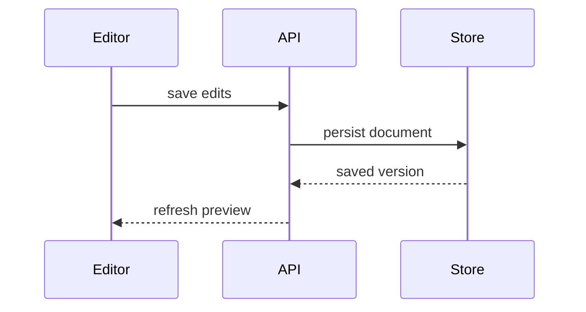

# PR writing examples

These examples illustrate formats. Replace their paths, identifiers, and results with those from the actual change. Report verification results only when you have observed them.

## Summary visuals

Choose the view that answers the reviewer's question. Keep the comparison next to the short explanation it supports.

### File responsibilities

Use a shallow tree to explain ownership or a broad refactor:

```text
src/
├── commands/       # parses user actions
├── sessions/       # owns session state
└── transport/      # sends API requests
```

### Logic

Use pseudocode to explain a decision:

```text
on(load document)
  if cached version matches stored version
    return cached document
  fetch stored document
  replace cached document
```

### Runtime flow

Use a call tree to make execution order clear:

```text
saveDocument
  validateChanges
  writeDocument
  refreshPreview
```

### UI structure

Use a component tree to show state ownership and module boundaries:

```text
<DocumentEditor>             # owns unsaved changes
  <EditorToolbar>            # shared UI package
    <SaveButton>
  <DocumentPreview>          # reads saved content
```

### Interactions

Use Mermaid when messages between components explain the behavior:



### Changes to existing flow

Use a diff sketch to isolate a changed step:

```diff
 saveDocument
   validateChanges
   writeDocument
+  invalidateCachedDocument
   refreshPreview
```

### Complete target shape

Use a whole block when reviewers need the complete new structure:

```text
document/
├── load.py       # reads persisted documents
├── save.py       # validates and writes edits
└── cache.py      # caches reads and invalidates saved documents
```

## Before/after evidence

Show the same input, action, or measurement before and after the change. State the comparison conditions and any missing run. An illustrative example explains behavior but does not prove that a fix works.

### Failing and passing test

When both runs were observed, include the test identity and the result:

```markdown
- **Before:** `test_preview_updates_after_save` failed. The preview
  contained `original` after saving `updated`.
  **After:** The same test passed. The preview contained `updated`.
```

### UI comparison

Link captured screenshots showing the same action and viewport:

```markdown
- **Before:** [Preview after saving](attachments/preview-before.png)
  still shows the previous text at a 390 px viewport width.
  **After:** [Preview after saving](attachments/preview-after.png)
  shows the saved text at the same viewport width.
```

### Performance comparison

Include a comparable workload and measurement conditions:

```markdown
- **Before:** Loading the same 1,000 documents took a median 420 ms
  across 20 runs on the same machine with an empty cache per run.
  **After:** The identical workload took a median 180 ms.
```

### Missing baseline

When only the updated behavior was checked, state that limit:

```markdown
- **Before:** Baseline not run. The reported failure was a stale preview
  after saving.
  **After:** `test_preview_updates_after_save` passed on the updated code.
```
